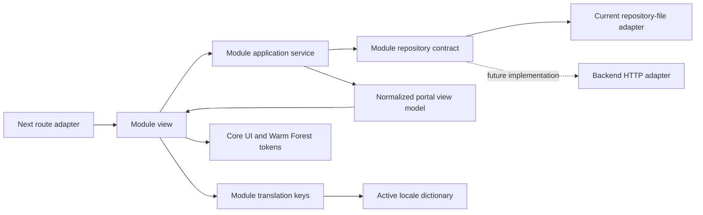

# AstraFlow Portal Architecture Refactor

**Status:** Approved for implementation  
**Date:** 2026-11-14

## Intent

Refactor the Next.js portal so page features, UI copy, design, data access, localization, and search metadata have clear owners. Keep today’s public portal stable while making it straightforward to add a backend data source, a second locale, new documentation, and new portal features without spreading changes across unrelated routes.

The portal remains an English-only developer site for this work. English keeps the current unprefixed URLs. Arabic is the first planned additional locale and is RTL, but this work adds no Arabic copy, Arabic public routes, or language switcher.

## Goals

- Keep all current routes, anchors, content, interactions, release semantics, and static build behavior.
- Group each page’s presentation, application logic, repository contract, source adapter, and translation messages under `portal/src/modules/{module}/{sub-module}/`.
- Keep shared UI primitives, shell, motion, design tokens, locale handling, API adapters, and SEO helpers in `portal/src/core/`.
- Move every user-visible interface string in React/TypeScript views, metadata, accessible names, controls, and error states to a feature-owned translation key resolved as `t(...)`.
- Use the current repository files as the source adapter for package facts, changelog entries, documentation, and community content. Keep feature services dependent on repository contracts so a future HTTP/backend adapter can supply the same normalized view models.
- Keep developer documentation as isolated Markdown content rather than embedding long prose in components or translation dictionaries.
- Preserve the Warm Forest visual system and prepare layout direction through locale metadata and CSS logical properties.
- Strengthen technical SEO and AI-answer discovery using accurate metadata, crawlable rendered content, semantic HTML, canonical URLs, sitemaps, and truthful structured data.
- Preserve the product-only content firewall and avoid naming outside assertion-library brands.

## Non-goals

- Redesigning the Warm Forest visual identity or changing the portal’s information architecture, routes, or visible behavior.
- Connecting to a real backend before endpoint contracts, authentication, caching, and deployment configuration are available.
- Publishing Arabic translations, exposing `/ar` routes, or adding a language selector before the Arabic content is complete.
- Claiming that schema, special AI files, or any implementation can guarantee indexing, ranking, or citation by a search or AI engine.
- Publishing, deploying, pushing, or merging the branch.

## Approaches considered

1. **Keep the current domain-first structure and improve individual files.** This has the least file movement and is the easiest short-term option. It leaves route views, domain services, copy, and layout concerns spread across separate folders, so future changes still cross several ownership boundaries.
2. **Feature-owned modules with shared platform services — selected.** Keep Next.js App Router as the public route layer, move each route’s own view/data/copy into a module, and reserve `core` for genuinely shared facilities. This directly supports backend adapters, locale-specific copy, and isolated design changes while preserving the current UI. It requires careful file moves and import updates.
3. **A generic schema-driven page engine.** This centralizes content configuration but would add indirection to interactive scenes such as the package composer, docs search, and release folio. It is a poor fit for the portal’s distinct page behavior.

The selected approach is option 2. The user delegated the architecture choice and added the backend, localization, RTL, SEO, and AI-search requirements; feature-owned modules best fit those constraints without replacing the existing design or page experiences.

## Architecture

### Route and feature ownership

`src/app` becomes a thin Next.js route adapter layer. Each route supplies Next metadata and route parameters, then delegates page rendering and data loading to its owning module. The docs detail route remains a static route backed by the docs repository.

```text
portal/src/
  app/[locale]/...                 Next.js route adapters and layouts
  modules/
    site/home/                      Home view, service, repository, home.en.ts
    catalog/packages/               Package directory and stack composer
    documentation/index/            Docs search and category view
    documentation/article/          Static docs article route and enhancements
    learning/guides/                Guide content and learning view
    releases/changelog/             Release parsing, policy, and presentation
    community/contribution/         Community source and contribution view
  core/
    api/                            Backend client contract and adapters
    design/                         Warm Forest tokens and global styles
    i18n/                           Locale config, message loader, t helpers
    locales/module-registry.ts      Registers active module dictionaries
    seo/                            Metadata, canonical, and JSON-LD helpers
    shell/                          Header, footer, navigation, skip link
    ui/                             Shared accessible controls and primitives
    motion/                          Shared motion and smooth-scroll facilities
    hairline/                        Shared geometry/rendering primitives
  content/docs/                     Long-form developer docs in Markdown
```

Each module has one public entry point. Other modules import that public surface or a `core` API; they do not reach into another module’s private data, repositories, or components. Add a `@core/*` TypeScript alias and import shared controls through `@core/ui/*`. Feature views use shared button/input/select/textarea components rather than raw form tags; native elements live inside the shared primitives. Shared primitives stay independent of page-specific content.

### Data and future backend boundary

The intended flow is:



Repository contracts return portal-owned models, not backend DTOs. Client-driven features follow `View → ViewModel hook → Repository → Service → API client → HTTP`; the current portal has no runtime backend request, so server route loaders use the same boundaries without a client hook. The current package source adapter reads project metadata and the explicit per-package release facts; docs/changelog/community adapters read their existing content sources. A future backend adapter can implement the same repository contract and map its response into portal models without changing views. Modules and views never import API endpoints, `IApiService`, or transport DTOs directly.

Package release facts remain explicit because packages can publish on different dates and versions. The package refactor should consolidate package identity, curated display keys, and release facts into a typed registry, derive display order from that registry, and validate every entry against discovered project files. This removes behavior branches such as a package-ID-specific publication conditional while keeping auditable release data. It does not introduce runtime NuGet lookups.

Filesystem access stays in server-only adapters used during static generation. Client components receive serialized view models and do not import filesystem code, backend DTOs, or repository implementations. No backend endpoint or HTTP data adapter is wired until its contract is known.

### Localization and content

- Use `next-intl` with App Router integration, typed message keys, and the server/client translation APIs. In each component or server function, resolve a translator as `t` and render interface copy with `t('...')`.
- Store interface messages with their owning module, such as `modules/catalog/packages/packages.en.ts`. A future `packages.ar.ts` belongs beside it after Arabic copy is ready. The locale registry in `core/locales/module-registry.ts` assembles only the active locale and the message namespaces required by the rendered feature.
- Use the server translation API for server views and metadata; use the client hook for interactive client components. Never pass a translation function across a server/client boundary.
- English is the only active locale. Use `localePrefix: 'as-needed'` and disable automatic locale negotiation so `/`, `/packages`, `/docs`, and other current URLs remain stable and canonical. When the complete Arabic content exists, enable `ar` as a prefixed RTL locale (`/ar/...`), add its module-owned messages, and emit matching canonical/hreflang metadata and sitemap alternates.
- Locale configuration owns `lang` and `dir`. CSS uses logical properties so `dir="rtl"` can work without replacing layout styles. No Arabic page is exposed until its full translation and page metadata are ready.
- Keep API reference and guide prose in the docs content repository. Localize the UI around that content independently; do not put paragraphs or code examples into component literals.
- Move package summaries, capabilities, preset labels, navigation, button text, hints, accessible labels, alt text, errors, page metadata, and OG copy out of TSX/TS into module messages or structured product data.
- Add automated checks for missing message keys, mismatched active-locale dictionaries, and hardcoded user-visible JSX text/attributes.

### Design system and accessibility

- Preserve the Warm Forest palette, existing route sections, dimensions, animation behavior, logos, and responsive layout during moves.
- Keep palette, typography, spacing, border, surface, and motion values in shared design tokens. Feature CSS modules own layout details and use tokens for visual values.
- Build shared accessible controls under `core/ui` and use them for interactive form controls. Native elements may be used inside these primitives; feature views use the shared components.
- Preserve keyboard operation, visible focus, semantic landmarks, WCAG 2.2 AA contrast, reduced-motion behavior, and current smooth-scroll behavior.
- Keep motion, hairline/isometric geometry, shell components, and page-specific scenes in separate ownership areas so a design-system change does not require changing copy or data services.

### SEO and AI-search discovery

- Keep the existing Next.js Metadata API, canonical URL model, Open Graph image, `robots.txt`, and `sitemap.xml`; centralize their inputs in locale-aware route metadata and content registries.
- Generate each page’s title and description from its translation keys. Preserve canonical URLs and existing aliases. When Arabic is enabled, add only complete language alternates and matching sitemap alternates.
- Ensure important documentation and package facts are present as crawlable HTML text in the built output, with semantic headings, internal links, descriptive anchors, accessible images, and one clear page-level topic.
- Add structured data only for entities that are accurate and visible on the page. Validate it against the rendered content; it is for search understanding and eligible rich results, not a ranking promise.
- Treat AI-search visibility (often called answer-engine or generative-engine optimization) as a benefit of normal technical SEO and clear, useful content. Current Google Search guidance says AI features use the same SEO foundations, have no special schema or machine-readable-file requirement, and do not guarantee inclusion. Do not add speculative ranking files or unsupported markup.
- Add route-level checks for title, description, canonical, `lang`/`dir`, sitemap coverage, robots access, rendered text, valid JSON-LD, and absence of duplicate default-locale URLs. After a future deployment, Search Console and Bing Webmaster tools can be used to observe indexing and citations; deployment and account changes are outside this task.

## Migration and verification order

1. Record the existing route, UI, metadata, search, package provenance, and accessibility baseline from the current worktree without discarding its pending changes.
2. Add the shared locale registry, message types, `t` helpers, `core/ui`, and design-token boundaries while keeping English routes unprefixed.
3. Move one feature at a time into its `modules/{module}/{sub-module}` owner. Keep DOM structure, copy, CSS behavior, route slugs, and interactions equivalent during each move.
4. Move all rendered interface copy to the owning English messages and product data/content registries; add an AST-based check that rejects unlocalized visible JSX text and message-key validation.
5. Establish repository contracts and current file-backed adapters, consolidate package facts, and keep client components independent of source access.
6. Centralize localized metadata, canonical and sitemap generation, truthful structured data, and crawlability checks.
7. Run `npm run typecheck`, `npx eslint . --max-warnings 0`, `npm run build`, and `npm run test:e2e`; inspect route HTML and representative desktop/mobile/RTL-direction layouts for regressions.

## Acceptance criteria

- All existing URLs and documentation slugs still return the same content and interactions; no `/en` duplicates, Arabic routes, or language switcher appear now.
- English is the only active message catalog. Every user-visible UI string is resolved through a module `t()` key; the hardcoded-copy guard passes.
- Every feature owns its page copy and data behavior under `src/modules/{module}/{sub-module}`. Shared code stays under `src/core` and cross-feature imports use public module surfaces.
- Current repository-file sources build the portal as before; data views depend on module repository contracts, making a future HTTP adapter an isolated implementation.
- Package release status is data-driven, validated, and has no `id !== ...` publication branch. The catalog and manifest cannot silently drift from actual package projects.
- Warm Forest tokens, route layout, mobile layout, keyboard behavior, focus visibility, reduced motion, and current animation/scroll behavior remain intact.
- Every public route has accurate translated metadata and canonical URL; sitemap and robots are valid; structured data is valid and matches visible content.
- Assertions, CLI, package, changelog, and API docs remain product-only, accurate to shipped/planned state, and contain no outside assertion-library brand references.
- Typecheck, zero-warning lint, production build, and the complete Playwright suite pass. The build retains static generation for the current English routes.
- No package is published and no branch is pushed or deployed.

## Known risk and mitigation

The portal has many client scenes and a large uncommitted set of API/documentation work on the shared 2.4.0 branch. The refactor must preserve that state. Move one module at a time, keep public route adapters stable, compare the visible page against the recorded baseline, and run route-specific browser checks before proceeding. Locale routing, message extraction, and CSS logical-property changes get separate verification so failures can be traced to one boundary.

## References

- [Next.js Metadata and Open Graph](https://nextjs.org/docs/app/getting-started/metadata-and-og-images)
- [Next.js generated sitemaps and language alternates](https://nextjs.org/docs/app/api-reference/file-conventions/metadata/sitemap)
- [next-intl routing configuration](https://next-intl.dev/docs/routing/configuration)
- [next-intl server and client translations](https://learn.next-intl.dev/chapters/03-translations/02-server-client-components)
- [Google Search AI features](https://developers.google.com/search/docs/appearance/ai-features)
- [Google generative AI search optimization guide](https://developers.google.com/search/docs/fundamentals/ai-optimization-guide)
- [Google sitemap guidance](https://developers.google.com/search/docs/crawling-indexing/sitemaps/build-sitemap)
